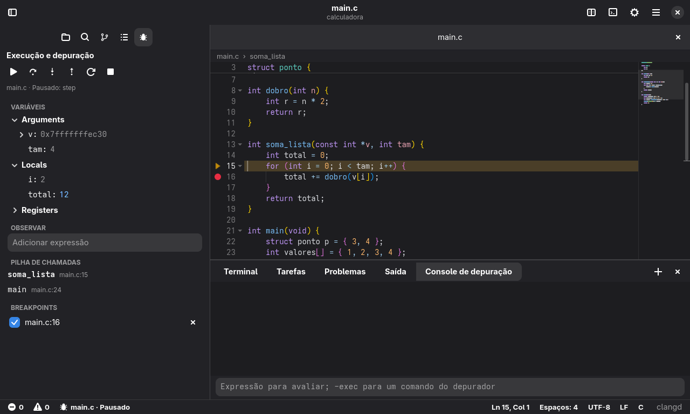
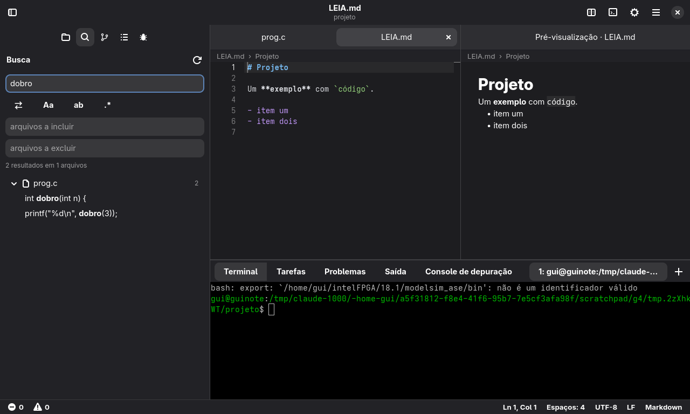
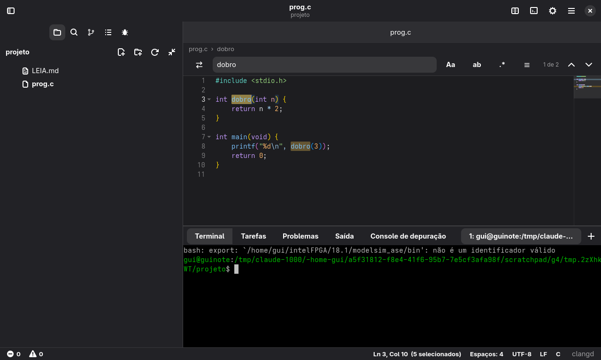

# Tinta para GNOME

Um editor de código para o GNOME, em Rust com **GTK 4 e libadwaita**. É um fork do
[Tinta](https://github.com/DrakRosmann/cosmic-ext-tinta), feito com o libcosmic: o motor é o mesmo,
e a interface foi reescrita com os componentes do GNOME.







## Feito com os componentes do GNOME

- Janela, cabeçalho e menu principal do libadwaita; abas em `AdwTabView`, que dá para reordenar
  ou levar de uma divisão para outra arrastando; divisões lado a lado com largura ajustável, que a
  sessão guarda
- Barra de ícones à esquerda (Explorador, Busca, Controle de versão, Estrutura, Depurar e
  Configurações): fica mesmo com a barra lateral fechada; clicar no ícone da vista aberta recolhe
  a barra lateral, que desliza. O ícone do controle de versão mostra quantos arquivos mudaram
- Cabe numa janela estreita, até 360 px: a barra lateral passa a flutuar sobre o texto
  (`AdwOverlaySplitView`) e sai da frente quando um arquivo abre, as opções da busca vão para um
  menu e a barra de status fica com o essencial
- Preferências em `AdwPreferencesDialog`, com busca; avisos em `AdwToast`; diálogos em
  `AdwAlertDialog`; "Sobre" em `AdwAboutDialog`
- Terminal VTE, o mesmo do Console e do GNOME Terminal
- Árvore de arquivos e resultados de busca em `GtkListView`: só as linhas visíveis existem
- Segue o claro e o escuro do sistema, a **cor de destaque** e a fonte de largura fixa do GNOME, e
  muda junto quando elas mudam
- Barra de cima editável: um clique com o botão direito nela, ou "Editar barra superior…" no menu,
  escolhe quais comandos viram botões, de que lado e em que ordem. Cada botão mostra o atalho ao
  passar o mouse. Os botões trocam de lugar pelas setas ou arrastando
- Uma janela só: `tinta-gnome arquivo` abre na janela que já está aberta (pelo `GtkApplication`)
- Acentos com teclas mortas e métodos de entrada pelo GTK. Em ambientes sem método de entrada, o
  editor e os campos de texto compõem sozinhos, então `´` e `a` ainda dão `á`

O texto é um widget próprio desenhado com o GSK, e não o `GtkSourceView`: é o que mantém os
recursos do editor, como múltiplos cursores, seleção em coluna, dobras pela árvore de sintaxe,
minimapa, modo Vim e a margem de breakpoints. Para o leitor de tela (Orca) ele é uma caixa de texto
de verdade, pelo `GtkAccessibleText`: lê o conteúdo por caractere, palavra e linha, segue o cursor e
a seleção, ouve o que se digita e apaga, e sabe onde cada trecho está na tela.

Ele roda em qualquer ambiente com GTK 4. No COSMIC, por exemplo, segue o tema que o COSMIC passa
para os aplicativos GTK.

## O que ele faz

**Edição**

- Múltiplos cursores: `Ctrl+D` na próxima ocorrência, `Ctrl+Shift+L` em todas, `Alt+clique`,
  `Ctrl+Alt+↑/↓`, seleção em coluna com `Shift+Alt+arrastar` ou o botão do meio
- Fecha parênteses e aspas sozinho, digita por cima do que fechou, envolve a seleção
- Indentação automática, detecção de espaços ou tabs, comentar linha e bloco
- Mover, duplicar, juntar, ordenar, inverter, embaralhar e tirar duplicatas de linhas
- Maiúsculas, minúsculas, `snake_case`, `camelCase`, `PascalCase`, `kebab-case`
- Expandir a seleção (palavra → dentro dos parênteses → com os parênteses → linha → tudo)
- Desfazer e refazer por agrupamento, como nos editores que você já conhece
- Snippets com pontos de parada, embutidos para as linguagens mais comuns e seus próprios em JSON
- Teclas mortas e métodos de entrada: `á`, `ç`, `ã` no ABNT2 funcionam, CJK também
- Modo Vim, nas configurações ou em "Alternar modo Vim" (veja abaixo)

**Visualização**

- Destaque de sintaxe para 220 gramáticas, incremental: digitar no meio de um arquivo de
  300 mil linhas reprocessa só o que mudou
- 13 temas de cores para o código, além do padrão e do Adwaita (a paleta do GNOME), que
  acompanham o claro e o escuro do sistema
- Parênteses coloridos por profundidade, ignorando strings e comentários
- Minimapa, guias de indentação, rolagem aderente, réguas, espaços visíveis
- Dobra de código, quebra de linha, números de linha absolutos ou relativos, a partir da árvore de
  sintaxe (tree-sitter) em Rust, Python, C, C++, JavaScript, TypeScript, Go, Java, Bash, JSON, HTML
  e CSS, e da indentação nas outras linguagens
- Destaque do par do parêntese e das ocorrências da palavra sob o cursor
- Breadcrumbs, divisão em vários grupos, modo zen, tela cheia
- Pré-visualização de Markdown ao lado do texto

**Navegação**

- Paleta de comandos (`Ctrl+Shift+P`) com busca aproximada e todos os comandos
- `Ctrl+P` para arquivos; digitando `>` vira comandos, `:` vira linha, `@` vira símbolo
- Voltar e avançar, marcadores, próximo problema, próxima alteração do git
- Estrutura do arquivo na barra lateral
- A árvore de arquivos pelo teclado: `Ctrl+Shift+X` vai até ela, as setas andam e abrem pastas
  (`→` abre e entra, `←` fecha e sobe), `Enter` abre, `Espaço` abre e continua na árvore, `F2`
  renomeia, `Delete` manda para a lixeira, uma letra pula para o nome e `Esc` volta ao texto
- As outras listas da barra lateral também, pelo teclado: `↓` no campo de busca ou na mensagem de
  commit desce para a lista, "Mostrar estrutura", "Mostrar controle de versão" e "Mostrar depuração"
  vão direto a ela. As setas andam, `Enter` faz o que o clique faz, `→`/`←` abrem e fecham os
  arquivos da busca e as variáveis, `Espaço` prepara ou tira um arquivo do commit, `F2` muda o valor
  de uma variável e `Esc` volta ao texto

**Busca**

- Localizar e substituir com expressão regular, palavra inteira, maiúsculas, dentro da seleção
- Busca na pasta inteira, respeitando o `.gitignore`, com filtros de arquivos e substituição, que
  alcança todas as ocorrências mesmo quando a lista na tela para em um limite

**Inteligência de código (LSP)**

Usa os servidores de linguagem que estiverem instalados, sem configuração: rust-analyzer, clangd,
pyright, gopls, typescript-language-server, lua-language-server e os de mais de vinte outras
linguagens.

- Sugestões ao digitar, misturadas com palavras do arquivo e snippets
- Sem o servidor da linguagem instalado, um aviso no topo diz qual instalar e copia o comando da
  sua distribuição (Arch, Fedora, Debian e Ubuntu) ou do instalador da linguagem (rustup, npm, go)
- Mesmo sem servidor, e em arquivos sem título, as sugestões trazem as palavras da linguagem: as
  palavras-chave e as funções, tipos e macros que vêm com ela (`println!`, `printf`, `len`,
  `console`…), em Rust, C, C++, Python, JavaScript, TypeScript, Go, Java, C#, Kotlin, Swift, PHP,
  Ruby, Lua, Bash, SQL, HTML e CSS
- Informações ao passar o mouse, dicas de parâmetros
- Ir para definição, declaração, implementação e tipo; localizar referências
- Renomear símbolo em todos os arquivos, formatar, correções rápidas
- Problemas sublinhados, com a mensagem no fim da linha e um painel com todos
- Envio parcial: o servidor recebe só o trecho alterado, se aceitar isso

**Depurador (DAP)**

`F5` compila e roda, e pronto. Usa o `gdb` 14 ou mais novo, o `lldb-dap`, o `debugpy` ou o `dlv`,
os que estiverem instalados. Os testes rodam contra programas de verdade no gdb 15, 16, 17 e 18 e no
debugpy. O gdb 14 é aceito, mas não foi testado, e o lldb-dap e o dlv usam o mesmo código, mas ainda
não foram experimentados.

- Breakpoints com um clique à esquerda dos números de linha ou `F9`, condicionais com `Shift+F9`.
  Acompanham o código quando o arquivo muda e continuam lá da próxima vez
- Variáveis em árvore, com o que mudou desde a última parada em destaque, e expressões observadas.
  Um clique duplo no valor, ou "Mudar valor…" no botão direito, troca o valor com o programa pausado
- `Ctrl+F10` roda até a linha do cursor, sem deixar breakpoint para trás; sem sessão, começa uma e
  vai até lá
- Pilha de chamadas e threads: clicar em um nível mostra aquele nível
- Passar o mouse sobre um nome, com o programa pausado, mostra o valor
- No gdb e no Python (debugpy), o programa ganha um terminal próprio no painel, "Programa": a saída
  aparece ali, e o que se digita ali chega a ele (o `scanf` e o `input` funcionam). Com
  `"console": "internalConsole"` no `launch.json`, a saída volta para o console, sem entrada
- Console que avalia expressões; `-exec` manda um comando ao depurador
- Um erro de compilação aparece no código como qualquer outro, e a sessão não começa

Sem configuração, ele compila o arquivo aberto (C e C++), usa `cargo`, `make` ou `cmake`, ou roda o
arquivo (Python e Go). Para o resto, ou para passar argumentos, há o `.tinta/launch.json`, que aceita
também o formato do VS Code. O comando "Editar launch.json" cria um modelo:

```jsonc
[
  {
    "name": "Servidor",
    "type": "gdb",                 // gdb, lldb, python ou go
    "build": "make -j8",           // opcional: a sessão só começa se der certo
    "program": "${workspaceFolder}/build/servidor",
    "args": ["--porta", "8080"],
    "cwd": "${workspaceFolder}",
    "env": { "LOG": "debug" },
    "stopOnEntry": false,
    "console": "integratedTerminal" // ou "internalConsole"
  }
]
```

**Tarefas de build**

- `Ctrl+Shift+B` roda o build; a paleta lista o que o projeto oferece: cargo, make, just, cmake,
  meson, go, npm, pytest e o seu `.tinta/tasks.json`
- Os erros aparecem no código e no painel de problemas, e `F6` e `Shift+F6` pulam de um para o outro
- No terminal, `Ctrl+clique` abre `arquivo:linha` e links

**Executar arquivos**

`Ctrl+F5` (ou `Ctrl+Alt+N`, ou o botão ▶ no cabeçalho) roda o arquivo aberto, sem depurador, em
cerca de 70 linguagens: Python, JavaScript, TypeScript, Ruby, Perl, PHP, Lua, R, Julia, Bash, Fish,
PowerShell, Elixir, Erlang, Haskell, OCaml, F#, C#, Java, Kotlin, Scala, Groovy, Clojure, Swift,
Dart, Go, Rust, C, C++, Zig, Nim, Crystal, Odin, D, Fortran, Pascal, Ada, COBOL, Assembly, Verilog,
Prolog, Racket, Scheme, Common Lisp, SQL, LaTeX, Typst e outras.

- O programa roda numa aba própria do terminal, então o `input()` e o `scanf` funcionam. No fim
  aparece o código de saída e quanto tempo levou, e a aba fica lá com a saída até a próxima vez
- Linguagens compiladas compilam primeiro, pelo painel de tarefas: um erro de compilação aparece no
  código, e o programa só roda se compilar
- O comando vem do projeto quando ele diz mais que o arquivo: `cargo run` com o alvo certo
  (`--bin`, `--example`, `--test`), `go build` no módulo, o Python do `.venv`, `uv run`,
  `poetry run`, Deno ou Bun, e `make` ou `cmake`. Depois do projeto vale o shebang (`#!`)
- Cada linguagem tem uma lista de programas, e vale o primeiro instalado (`tsx`, `bun`, `deno`,
  `node` para TypeScript, por exemplo). Sem nenhum, um aviso diz qual instalar e copia o comando da
  sua distribuição
- HTML abre no navegador, Markdown abre a pré-visualização
- Texto sem título também roda: é salvo numa pasta temporária com a extensão da linguagem
- "Executar arquivo com argumentos…" pede os argumentos, que ficam guardados para aquele arquivo e
  aceitam o que o terminal aceita (`--n 3 < entrada.txt`). "Executar de novo o último arquivo"
  repete; `Ctrl+Alt+M` para, como um `Ctrl+C`
- `Shift+Enter` manda a seleção, ou a linha atual, ao REPL da linguagem (Python, Node, Ruby, R,
  Julia, GHCi, OCaml, IEx, Clojure, Lua, SQLite, jshell e outros) e passa para a próxima linha. Em
  linguagens sem REPL, `Shift+Enter` continua sendo uma quebra de linha

Para mudar o comando de uma linguagem, use `runCommands` nas configurações ou `.tinta/run.json` no
projeto ("Editar run.json" cria um modelo). A chave é o nome da linguagem ou a extensão:

```jsonc
{
  "Python": "python3 -X dev ${file}",
  ".c": { "build": "cc -O2 -Wall -o ${out} ${file} -lm", "run": "${out}" },
  "Rust": { "run": "cargo run -q --release -- ${args}", "cwd": "${workspaceFolder}" }
}
```

As variáveis já vêm entre aspas: `${file}`, `${fileDirname}`, `${fileBasename}`,
`${fileBasenameNoExtension}`, `${workspaceFolder}`, `${out}` e `${outDir}`. Os argumentos vão no
fim, ou onde estiver `${args}`.

**Sistemas embarcados**

Arduino, Raspberry Pi Pico, STM32, ESP32 e outras placas, em C, C++ e Rust. O Tinta reconhece o
projeto pelos arquivos dele, sem configuração:

| Projeto | Reconhecido por | Compila, grava e mostra a saída com |
| --- | --- | --- |
| PlatformIO | `platformio.ini` | `pio run`, `-t upload`, `pio device monitor` |
| Arduino | um `.ino` na pasta | `arduino-cli compile` e `upload` |
| Rust | `.cargo/config.toml` com um alvo sem sistema (`thumbv7m-none-eabi`…) | `cargo build` e o `runner` do `cargo run` (probe-rs, elf2uf2-rs, espflash) |
| Raspberry Pi Pico | `pico_sdk_init()` no `CMakeLists.txt` | CMake, e o `picotool` ou o disco do BOOTSEL |
| ESP-IDF | `sdkconfig` ou o `project.cmake` do IDF | `idf.py build`, `flash` e `monitor` |
| Zephyr | `find_package(Zephyr)` | `west build` e `west flash` |
| STM32CubeMX | um `.ioc` | o Makefile ou o CMake que ele gerou |
| Makefile ou CMake | `arm-none-eabi`, `riscv…-elf`, `avr-gcc` nele | `make` ou CMake |

- Num projeto de firmware, a barra de cima ganha os botões do Arduino IDE: **verificar** (✓,
  `Ctrl+Alt+R`, só compila), **gravar na placa** (›, `Ctrl+Alt+U`) e o **monitor serial** (⇄,
  `Ctrl+Alt+S`). `Ctrl+F5` faz tudo: compila (os erros vão para o código, como em qualquer build),
  grava e abre o monitor conectado
- Sem o projeto dizer como gravar, vale o primeiro programa instalado que serve: probe-rs,
  STM32CubeProgrammer, OpenOCD, st-flash, pyOCD ou J-Link; no Pico, o `picotool` ou a cópia do
  `.uf2` para o disco que ele mostra no BOOTSEL. O chip do OpenOCD vem do nome do STM32
  (`STM32F103C8` → `target/stm32f1x.cfg`)
- O **monitor serial** é um painel próprio, embaixo: conectar e desconectar, a porta e a velocidade,
  o que a placa escreve (com a hora de cada linha, se quiser) e um campo que manda uma linha com o
  fim de linha escolhido (nenhum, LF, CR ou CR+LF). Ele espera a porta aparecer e, quando a placa
  reinicia, espera ela voltar. Rolado para cima, ele não pula para o fim a cada linha nova
- **Gravar libera a porta**: o monitor solta a porta durante a gravação e se conecta de novo
  quando ela termina, sem precisar fazer nada
- O **gráfico serial** ("Embarcado: gráfico serial", ou o botão de gráfico no monitor) desenha os
  números de cada linha, como o Serial Plotter do Arduino: `21.5 40`, `21.5,40` ou com nome,
  `temp:21.5,umid:40`, uma série para cada um, com o valor atual na legenda
- A barra de status mostra a placa e a porta: um clique escolhe a placa (o ambiente do PlatformIO,
  a placa do Arduino, com as ligadas no USB primeiro, ou o modelo do Pico) ou a porta. Uma porta
  sem permissão diz qual comando resolve (`sudo usermod -aG dialout $USER`). As escolhas ficam
  guardadas neste computador, fora do projeto
- `F5` depura na placa, com breakpoints, variáveis, pilha e registradores: pelo probe-rs, que grava
  e depura, ou por um servidor GDB (OpenOCD, st-util, J-Link, pyOCD), com o gdb que fala DAP
  (`gdb-multiarch`, `arm-none-eabi-gdb` ou o `gdb` do sistema, se ele conhece ARM). A sessão
  reinicia o chip, grava o firmware e para em `main`. Parar a depuração solta a placa, que
  continua rodando
- O clangd pergunta ao compilador cruzado onde estão os cabeçalhos dele, e o rust-analyzer não
  checa testes num crate sem `std`, que não teria como compilá-los. Arquivos `.ino` têm as cores
  do C++, sem o clangd, que não compila um sketch sozinho
- "Embarcado: novo projeto…" cria um projeto que pisca o LED, pronto para compilar, gravar e
  depurar: sketch do Arduino, PlatformIO (Uno, ESP32 e Nucleo), Pico em C (Pico SDK) e em Rust,
  e STM32F103 "Blue Pill" em C (sem HAL, com Makefile e linker script) e em Rust

O que os arquivos não dizem vai no `.tinta/embedded.json` ("Embarcado: editar embedded.json" cria
um modelo):

```jsonc
{
  "chip": "STM32F103C8",           // para o probe-rs, J-Link e pyOCD
  "probe": "openocd",              // probe-rs, openocd, stlink, stm32programmer, jlink, pyocd, picotool, uf2
  "openocd": ["interface/stlink.cfg", "target/stm32f1x.cfg"],
  "board": "arduino:avr:uno",      // FQBN, ambiente do PlatformIO, placa do Pico ou do Zephyr
  "port": "/dev/ttyACM0",
  "baud": 115200,
  "build": "make -j8",             // e "flash", "monitor" e "clean", para usar os seus
}
```

No `.tinta/launch.json`, o tipo `embedded` depura por um servidor GDB e aceita as chaves do
Cortex-Debug do VS Code (`"type": "cortex-debug"` também vale); `probe-rs-debug` é o do probe-rs:

```jsonc
[
  {
    "name": "Placa",
    "type": "embedded",
    "build": "make",
    "executable": "${workspaceFolder}/build/firmware.elf",
    "servertype": "openocd",        // openocd, stlink, jlink, pyocd ou external
    "configFiles": ["interface/stlink.cfg", "target/stm32f1x.cfg"],
    "device": "STM32F103C8",        // jlink e pyocd
    "runToEntryPoint": "main"
  },
  {
    "name": "QEMU",
    "type": "embedded",
    "servertype": "external",
    "executable": "${workspaceFolder}/build/firmware.elf",
    "serverCommand": "qemu-system-arm -M stm32vldiscovery -kernel build/firmware.elf -S -gdb tcp::3333 -nographic",
    "gdbTarget": "localhost:3333",
    "runToEntryPoint": "main"
  }
]
```

Também valem `"request": "attach"` (conecta sem reiniciar nem gravar), `"load": false`,
`gdbPath`, `serverpath`, `preLaunchCommands`, `postLaunchCommands` e `overrideLaunchCommands`. No
console, `-exec monitor reset halt` fala com o servidor.

**Pastas confiáveis**

Os arquivos `.tinta/run.json`, `.tinta/tasks.json`, `.tinta/launch.json` e `.tinta/embedded.json` de um projeto rodam
comandos no seu computador. Por isso, na primeira vez que um deles seria usado, o Tinta pergunta se
você confia na pasta. Confiando, a resposta fica guardada; sem confiar, os arquivos `.tinta` dela são
ignorados até fechar o editor, e o resto (o build detectado, o depurador sem configuração) continua
funcionando. "Confiar nesta pasta" e "Deixar de confiar nesta pasta" mudam a resposta depois.

**Git**

- Marcas na margem e no mapa da barra de rolagem, próxima alteração, reverter um trecho
- Preparar, descartar, commit, push, pull, fetch e troca de branch
- Diff lado a lado, com rolagem conjunta, cor de sintaxe e o trecho alterado em destaque. `F7` e
  `Shift+F7` pulam entre as alterações, e um clique duplo no lado novo abre o arquivo naquela linha
- Histórico e `git blame` na linha atual

**E o resto**

- Terminal integrado (o emulador do Alacritty), com vários terminais, seleção e cores
- Árvore de arquivos com menu de contexto, ícones do tema e cores do git
- Sessão restaurada ao abrir, e texto não salvo guardado entre execuções (o _hot exit_ do VS Code)
- Uma janela só: `tinta-gnome arquivo` manda o arquivo para a janela que já está aberta
- Salvamento atômico, salvar automaticamente, formatar ao salvar, limpar espaços no fim das linhas
- Codificações (UTF-8, UTF-16, Windows-1252, Shift JIS…) e fins de linha detectados e preservados
- Recarrega arquivos que mudaram no disco e pergunta se você tem alterações não salvas
- Abrir arquivos arrastando, ou na linha de comando: `tinta-gnome src/main.rs:10:4`
- Interface em português e inglês, conforme o idioma do sistema

## Instalação

```sh
git clone https://github.com/DrakRosmann/tinta-gnome
cd tinta-gnome
./install.sh          # instala em ~/.local
```

Precisa do GTK 4.18, do libadwaita 1.7 e do VTE para GTK 4 (Fedora 42, Ubuntu 25.10, Debian 14 ou
mais novos). O `deps.sh` instala o que faltar com `apt`, `dnf` ou `pacman`. Depois é abrir "Tinta"
no lançador, ou rodar `tinta-gnome [arquivo ou pasta]`. Ele instala ao lado do Tinta original, com
nome, ícone e configurações próprios.

Para placas, instale as ferramentas da sua: `arm-none-eabi-gcc` e um gravador (probe-rs ou
OpenOCD) para STM32 e Pico, o `arduino-cli` ou o PlatformIO, o ESP-IDF. Quando falta alguma, um
aviso diz qual e copia o comando que a instala. As sondas USB precisam das regras do udev delas
(as do [probe-rs](https://probe.rs/docs/getting-started/probe-setup/) servem para quase todas), e
as portas seriais, do grupo `dialout` (`uucp` no Arch).

Para ter inteligência de código, instale o servidor da sua linguagem: `rustup component add
rust-analyzer`, `dnf install clang-tools-extra` e assim por diante. Ele é encontrado no `PATH`.

### Flatpak

```sh
flatpak install --user flathub org.gnome.Sdk//51 org.freedesktop.Sdk.Extension.rust-stable//26.08 org.flatpak.Builder
flatpak run org.flatpak.Builder --user --install --force-clean flatpak-build io.github.DrakRosmann.TintaGnome.json
flatpak run io.github.DrakRosmann.TintaGnome
```

A compilação não usa a rede: os crates vêm de `build-aux/flatpak/cargo-sources.json`, que se gera
de novo com `build-aux/flatpak/cargo-sources.py` sempre que o `Cargo.lock` muda.

O editor fica na sandbox, mas as ferramentas são as do seu sistema: o terminal abre o seu shell, e
git, compiladores, depuradores e servidores de linguagem rodam fora dela, por `flatpak-spawn
--host`. Por isso ele pede acesso aos arquivos e ao `org.freedesktop.Flatpak`. O terminal do
programa depurado atravessa a sandbox: o gdb o recebe como um descritor aberto, e o programa
Python nasce ligado a ele.

## Configuração

Tudo pode ser mudado na janela de configurações (`Ctrl+,`) ou à mão, em `~/.config/tinta-gnome/`. O
arquivo é relido ao salvar, sem reiniciar, e aceita comentários e vírgulas sobrando:

```jsonc
// settings.json
{
  "fontFamily": "JetBrains Mono",
  "fontSize": 15,
  "tabSize": 4,
  "wordWrap": false,
  "rulers": [80, 100],
  "formatOnSave": true,
  "syntaxTheme": "COSMIC",
  // Outro servidor para uma linguagem; "command" vazio desliga.
  "lspServers": {
    "python": { "command": "ruff", "args": ["server"] }
  },
  // Como o Ctrl+F5 roda uma linguagem, antes da tabela embutida.
  "runCommands": {
    "Python": "python3 -X dev ${file}"
  }
}
```

```jsonc
// keybindings.json: "-" libera uma tecla
[
  { "key": "ctrl+shift+n", "command": "file.new" },
  { "key": "ctrl+k ctrl+x", "command": "edit.trimTrailing" },
  { "key": "ctrl+t", "command": "-" }
]
```

```jsonc
// snippets.json, por linguagem
{
  "Rust": [
    { "prefix": "pr", "description": "println", "body": "println!(\"$1\");$0" }
  ]
}
```

A lista completa de atalhos está em `Ctrl+K Ctrl+S`, e os identificadores dos comandos em
[`keymap.rs`](crates/tinta-core/src/keymap.rs).

### Atalhos principais

| Atalho | Faz |
| --- | --- |
| `Ctrl+Shift+P` / `F1` | Paleta de comandos |
| `Ctrl+P` | Ir para arquivo |
| `Ctrl+G` | Ir para linha |
| `Ctrl+Shift+O` | Ir para símbolo |
| `Ctrl+F` / `Ctrl+H` | Localizar / substituir |
| `Ctrl+Shift+F` | Localizar nos arquivos |
| `Ctrl+D` | Próxima ocorrência como outro cursor |
| `Ctrl+Shift+L` | Todas as ocorrências |
| `Alt+↑` / `Alt+↓` | Mover linha |
| `Ctrl+Shift+D` | Duplicar |
| `Ctrl+Shift+K` | Apagar linha |
| `Ctrl+/` ou `Ctrl+;` | Comentar |
| `Ctrl+\` | Dividir o editor |
| `Ctrl+B` | Barra lateral |
| `Ctrl+J` / `` Ctrl+` `` / `Ctrl+'` | Painel / terminal |
| `F12` / `Ctrl+clique` | Ir para definição |
| `F2` | Renomear símbolo |
| `Ctrl+.` | Correção rápida |
| `Ctrl+Espaço` | Sugestões |
| `Alt+Z` | Quebra de linha |
| `Ctrl+Shift+V` | Pré-visualizar Markdown |
| `Ctrl+Shift+B` | Rodar o build |
| `Ctrl+F5` / `Ctrl+Alt+N` | Executar o arquivo |
| `Ctrl+Alt+M` | Parar a execução |
| `Shift+Enter` | Mandar a seleção ou a linha ao REPL |
| `F5` / `Shift+F5` | Iniciar ou continuar / parar a depuração |
| `F9` / `Shift+F9` | Breakpoint / breakpoint condicional |
| `F10` / `F11` / `Shift+F11` | Próxima linha / entrar na função / sair dela |
| `F7` / `Shift+F7` | Próxima alteração / anterior |
| `Ctrl+Shift+Y` | Console de depuração |
| `Ctrl+Alt+R` | Verificar (compilar o firmware) |
| `Ctrl+Alt+U` | Compilar e gravar na placa |
| `Ctrl+Alt+S` | Monitor serial |

`F11` é tela cheia, exceto durante uma sessão de depuração. "Ordenar linhas" não tem mais atalho:
`F9` agora é o breakpoint.

### Modo Vim

Os modos normal, inserir, substituir e visual (de caracteres, de linhas e em bloco), com contagens:

- Movimentos: `h j k l w b e W B E ge 0 ^ $ gg G f F t T ; , % { } H M L * # n N`, marcas
- Operadores: `d c y > < gu gU g~ gc`, dobrados para a linha inteira
- Objetos de texto: `iw aw iW aW` e `i`/`a` com `( [ { < " ' \` p`
- `x X s S D C Y p P r R J gJ ~ u Ctrl+R . Ctrl+A Ctrl+X`
- Registradores (`"a`, `"0`, `"_`, e `"+` para a área de transferência) e macros (`q`, `@`, `@@`)
- `/`, `?` e os comandos `:w :q :wq :x :qa :e :bd :sp :vs :tabn :tabp :noh :set :sort :d :N`, e
  `:s` com intervalo (`:%s/a/b/g`, `:'<,'>s/a/b/`), usando a sintaxe de expressões do Vim
- `gd gr gi gh` vão para a inteligência de código, `zc zo za zM zR` para as dobras

No modo inserir quem digita é o próprio editor, com sugestões e fechamento de parênteses. Os atalhos
com `Ctrl` que o Vim não usa, como `Ctrl+P` e `Ctrl+S`, continuam valendo.

## Como é feito

O projeto é dividido para que quase tudo possa ser testado sem abrir janela:

- **`crates/tinta-core`**: o motor, sem nenhuma dependência de interface. Texto em
  [ropey](https://github.com/cessen/ropey), cursores, desfazer, cores sobre as gramáticas do
  [syntect](https://github.com/trishume/syntect), estrutura com
  [tree-sitter](https://tree-sitter.github.io/), busca, git (pelo comando `git`), clientes LSP e DAP,
  o modo Vim, snippets, atalhos.
- **`crates/tinta`**: o aplicativo. Em `app/`, o estado e tudo o que acontece com ele: cada
  mensagem passa por um `update`, que devolve uma lista de efeitos (abrir um diálogo, copiar,
  focar um campo). Em `gui/`, o lado GTK: executa os efeitos e põe os widgets em dia com o estado.
  O texto e o diff são widgets próprios, desenhados numa grade de caracteres com o GSK e o Pango.
- **`crates/tinta-vkbd`**: digita em um compositor pelo protocolo de teclado virtual do Wayland,
  para os testes de ponta a ponta.
- **`crates/tinta-xptr`**: ponteiro real e capturas da tela real, para os mesmos testes.

## Testes

```sh
cargo test                                     # núcleo e interface, sem janela
cargo test --release large_file -- --ignored --nocapture   # mede um arquivo de 300 mil linhas
```

Os testes da interface não abrem janela: o teclado e os comandos vão direto ao `update`, e o mouse
passa pelo tratamento de eventos do próprio editor, nas mesmas posições em que ele desenha. O
cliente LSP é testado contra o clangd de
verdade quando ele está instalado, e o depurador contra o gdb e o debugpy, compilando e rodando
programas pequenos. Quem não tem essas ferramentas vê esses testes passarem sem fazer nada.

Para ver o aplicativo rodando, `tests/e2e/gnome.sh` abre um **GNOME Shell de verdade**, sem tela,
num D-Bus próprio e com as preferências do GNOME num arquivo próprio, nunca nas suas, e dirige o app
por um script que também tira capturas de tela:

```sh
cargo build --workspace
cat > /tmp/passos.txt <<FIM
wait 500
cmd palette.commands
input salvar
shot /tmp/paleta.png
quit
FIM
tests/e2e/gnome.sh /tmp/passos.txt color-scheme=prefer-dark
```

Os passos estão descritos em [`script.rs`](crates/tinta/src/app/script.rs).

`tests/e2e/a11y.sh` lê o editor como o Orca, pelo AT-SPI, num D-Bus e numa pasta de execução
próprios: confere o papel, o texto e os eventos de cursor, inserção e remoção.

Teclado e ponteiro de verdade precisam de um compositor que aceite os dois: `tests/e2e/run.sh`
digita pelo teclado virtual do Wayland (`tinta-vkbd`), com teclas mortas e tudo, num `cosmic-comp`
aninhado; `tests/e2e/pointer.sh` move e clica pelo `tinta-xptr` dentro de um Xwayland próprio, e
captura os pixels reais da tela. Nenhum dos dois mexe no seu teclado, no seu cursor ou na sua sessão.

## Licença

GPL-3.0-only. Este é um projeto independente, sem ligação com o GNOME.

## O que falta

- Sem extensões nem edição remota.
- No depurador: sem anexar a um processo em execução, nem breakpoints que só registram no console.
  O terminal do programa é só no gdb e no Python: no Go e no lldb, o programa não recebe o que se
  digita.
- No Vim: sem `:global`, `:normal`, mapeamentos próprios nem `.vimrc`.
- A quebra de linha fica desligada em arquivos acima de 4 milhões de caracteres.
